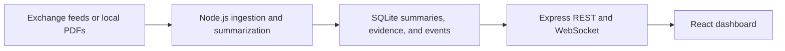
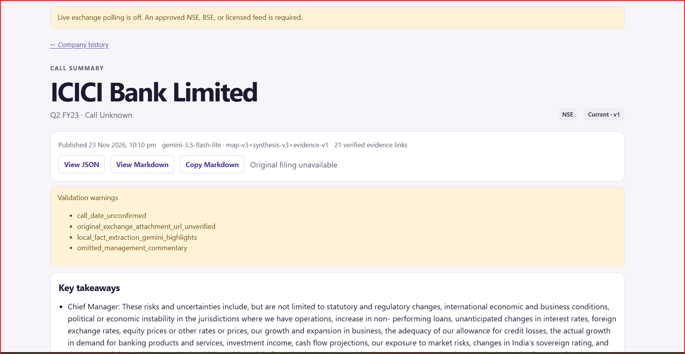
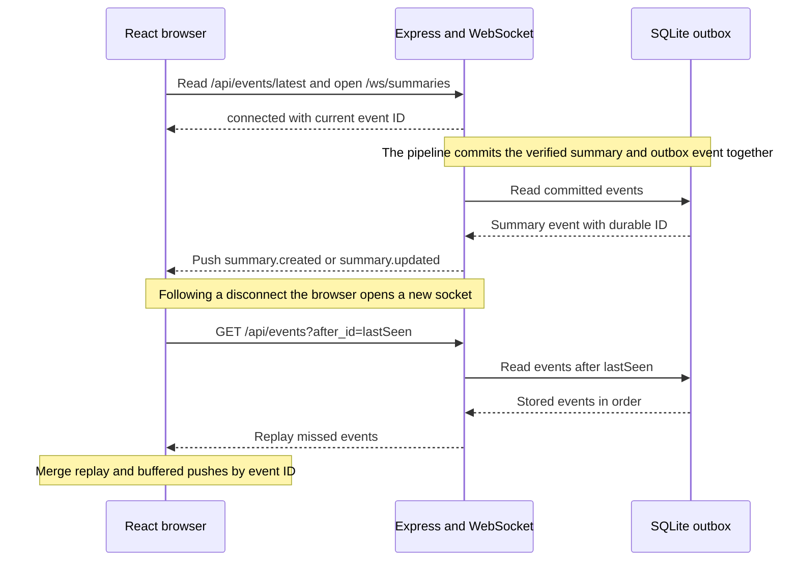

# Finosauras Earnings Call Intelligence

Finosauras turns earnings-call transcript PDFs into structured JSON and Markdown summaries with page-level evidence. The React dashboard shows an eight-company watchlist, company history, and revision-aware call summaries. An Express API serves the same records, and a WebSocket pushes new publications and corrections to connected browsers.

[Quick start](#quick-start) · [Architecture](#architecture) · [Processing approach](#processing-approach) · [Screenshots](#screenshots) · [API and live events](#api-and-live-events)

## Quick start

Install Node.js 22.12 or later in the Node.js 22 release line. From the repository root, install dependencies and start the app.

```sh
npm ci
npm run start:local
```

Open [localhost:3000](http://localhost:3000). `start:local` builds the frontend and serves it with the API and WebSocket in one process. After the first install, run `npm run start:local` again to start the app. Press Ctrl+C to stop it.

On a fresh checkout, the app uses the fixture profile and processes a bundled fictional transcript. Fixture mode needs no exchange credentials or Gemini key. Private settings go in `backend/.env`. `DATA_DIR` stores the SQLite database, saved summaries, private PDFs, and extraction artifacts across restarts. Its default is `./data`.

### Development

For live code reloading, run this after installing dependencies.

```sh
npm run dev
```

Open the URL printed by Vite. The development server proxies API and WebSocket calls to the backend.

## Architecture



The project has separate npm lockfiles under `frontend/` and `backend/`. The shared Zod contracts live in [backend/shared](backend/shared/). The [original architecture illustration](docs/readme-assets/architecture.png) shows the earlier deployment layout.

| Layer                     | Implementation                                                                                                            |
| ------------------------- | ------------------------------------------------------------------------------------------------------------------------- |
| Sources                   | A common filing adapter interface for approved NSE, BSE, and licensed feeds, bundled fixtures, and operator-supplied PDFs |
| Ingestion                 | Node.js and Undici for discovery, bounded downloads, durable job leases, retries, and recovery                            |
| Extraction and validation | PDF.js for text and page positions, Zod for contracts, and application checks for quotes and figures                      |
| Summarization             | Google Gemini via `@google/genai` for real transcripts and a deterministic provider for fictional fixtures                |
| Persistence and delivery  | SQLite in WAL mode via `better-sqlite3`, a transactional outbox, Express REST, and native WebSockets via `ws`             |
| Browser                   | React, React Router, Vite, and Tailwind CSS                                                                               |

One local Node.js service runs the pipeline. Express serves the built React app, API, and WebSocket on the same origin. SQLite stores jobs, polling cursors, revisions, evidence, and committed events. PDF bytes and page maps live in private storage under `DATA_DIR`.

## Processing approach

1. **Discover and filter.** Each NSE and BSE polling window checks for the subject `Analysts/Institutional Investor Meet/Con. Call Updates` and the standalone word `transcript` in the description. For matching subjects, the adapter checks linked XBRL XML from approved origins when present. Rows with an empty XBRL field use the exchange announcement details. The eight-company watchlist is the initial dashboard view.
2. **Download and deduplicate.** The downloader checks permitted hosts, redirects, size, and PDF validity. The pipeline links NSE and BSE copies when their ISIN, call date, quarter, and PDF SHA-256 all match. Different PDF bytes are reviewed separately, and incomplete or conflicting call metadata on identical bytes is held for review. Durable cursors and job leases let the pipeline resume after a restart with bounded retries.
3. **Extract and classify.** PDF.js preserves page numbers and text positions for the reading order, tables, and speaker blocks. Content checks distinguish transcript dialogue from cover letters and notices. Unconfirmed call dates and quarters stay unknown. Scanned, damaged, or unsupported files can require review.
4. **Summarize with evidence.** Gemini maps page-aware chunks to structured fact candidates and selects the evidence for each section of a real summary. The application checks the schema, source page, quote, and numerical evidence before producing JSON and deterministic Markdown. If Gemini is unavailable, the worker follows its retry policy and waits for a validated Gemini result before publishing.
5. **Commit and publish.** The verified summary, evidence, revision, and outbox event are saved atomically. A correction receives a new summary ID while earlier revisions remain available in company history. WebSocket subscribers receive the committed summary and can recover missed events over REST.

## Screenshots

These captures show historical transcript imports. The source badges identify the reported exchange, and the banner records that automatic exchange polling was disabled. Published times refer to the app's summary publication. Call dates appear separately when confirmed.

### Watchlist

The watchlist shows publication status by company and supports search, sector and quarter filters, and sorting.


### Company history

Company history shows issuer identifiers, verification status, and the available summary revisions.


### Summary, evidence, and export

The summary view shows the revision, model, validation warnings, and controls to view JSON or copy Markdown.



Evidence links open the quoted text and PDF page. The captured metrics row appears to pick up `19` from `Covid-19`. This is an example of an extraction error that page evidence helps readers catch.


Sections with no verified items stay empty. Published risk excerpts retain their page links.


## Configuration and real transcripts

Use [`backend/.env.example`](backend/.env.example) as the configuration template. Keep credentials in a private `backend/.env`.

| Profile             | Use                                                                        |
| ------------------- | -------------------------------------------------------------------------- |
| `fixture`           | Runs bundled fictional PDFs and a labeled deterministic mock.              |
| `authorized-direct` | Processes approved NSE and BSE feeds or PDFs you obtained with permission. |
| `licensed-feed`     | Uses an approved provider endpoint and its token when required.            |

### Import an existing PDF

For real transcript summarization, set `GEMINI_API_KEY` in the private `backend/.env` and use this profile for PDF imports with feed polling disabled.

```dotenv
DATA_MODE=authorized-direct
LIVE_POLLING_ENABLED=false
AI_PROVIDER=gemini
```

Restart the app after changing its environment. For the example below, select an authorized PDF for ICICI Bank and enter its original HTTPS exchange attachment URL.

```powershell
$pdf = Read-Host 'Path to the ICICI Bank transcript PDF'
$sourceUrl = Read-Host 'Original HTTPS exchange PDF URL'
if (-not (Test-Path -LiteralPath $pdf -PathType Leaf)) { throw 'PDF file not found' }
npm run db:verify-watchlist
npm.cmd run ingest:pdf -- --file "$pdf" --company ICICIBANK --source-url "$sourceUrl" --authorized --summarize
```

Use `--archive-exchange NSE` or `--archive-exchange BSE` in place of `--source-url` for a local archive with a matching exchange cover page. The app marks its original attachment link as unverified. The `--summarize` option grants Gemini permission for this PDF. Omit it to import and extract the PDF without requesting a summary.

### Refresh an earlier summary

After a pipeline upgrade, use the summary ID from the dashboard URL to refresh that transcript with Gemini. The PDF needs existing Gemini permission. The previous summary stays in company history and the refresh keeps the same transcript revision.

```powershell
npm.cmd run summarize:refresh -- --id="$summaryId"
```

The summary shows page evidence for verified items and labels unverified source links. The summary API includes validation warnings and coverage details.

### Enable automatic polling

Set `LIVE_POLLING_ENABLED=true` only after obtaining an approved feed. For `authorized-direct`, supply `NSE_FEED_URL` with `NSE_ACCESS_AUTHORIZED=true`, or `BSE_FEED_URL` with `BSE_ACCESS_AUTHORIZED=true`. For `licensed-feed`, supply `LICENSED_FEED_URL` and `LICENSED_FEED_AUTHORIZED=true`, plus the token if required by the provider. The template also lists attachment host settings.

- `POLL_INTERVAL_SECONDS=300` sets a five-minute cadence.
- `LIVE_MAX_DOCUMENTS_PER_POLL=0` queues all new eligible candidates. Set it to `1` to queue one per scan and mark the remaining candidates as skipped.
- `/api/status` shows source authorization, poll activity, and worker state. WebSocket connectivity reports summary delivery independently of exchange access.

## API and live events

| Endpoint                            | Returns                                                                      |
| ----------------------------------- | ---------------------------------------------------------------------------- |
| `GET /api/health/ready`             | Backend readiness                                                            |
| `GET /api/status`                   | Source, watcher, job, and provider status                                    |
| `GET /api/watchlist`                | Company availability and latest summary metadata                             |
| `GET /api/companies/{id}/summaries` | Company summary history                                                      |
| `GET /api/summaries/{id}`           | Structured summary, Markdown, revision, and validation metadata              |
| `GET /api/summaries/{id}/markdown`  | Plain Markdown                                                               |
| `GET /api/summaries/{id}/evidence`  | Page, quote, speaker, and claim references                                   |
| `GET /api/events?after_id=0`        | Committed event replay by event ID                                           |
| `WS /ws/summaries`                  | Connection watermark and full `summary.created` and `summary.updated` events |



## Verification and limitations

```sh
npm test
npm run lint
npm run format:check
npm run build
npm run --prefix frontend install:browsers
npm run test:e2e
npm run smoke:stage1
```

The browser tests exercise WebSocket publication, reconnect and replay, and summary revision history. The startup smoke test reopens the same SQLite storage across two local boots.

Automated exchange ingestion and current-quarter coverage depend on approved feed access. The captured runs use historical imports, and some lack verified original filing links. Text-based PDFs work best. Image-only PDFs, irregular tables, and ambiguous wording can require manual review. Evidence links show what the app used for a claim and make shortcomings such as the captured metric error visible.

## Project layout

```text
backend/                  API, adapters, workers, SQLite, and tests
  src/                    Config, routes, controllers, services, models, middleware, and utilities
  shared/                 Shared schemas and event contracts
  .env.example            Backend configuration template
frontend/                 React UI, Vite, and browser tests
docs/readme-assets/       Supplied screenshots and architecture diagram
package.json              Local startup, maintenance, and test commands
```

See the [backend README](backend/README.md) for file responsibilities and backend commands.
